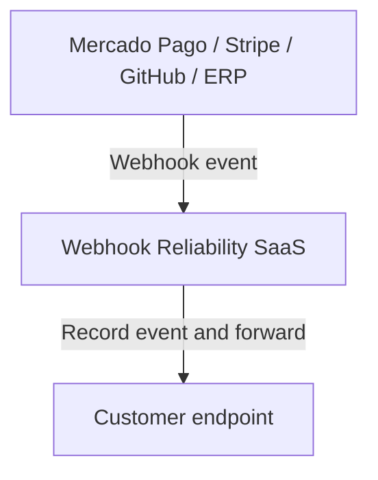

# Kerby API

A REST API built with ASP.NET Core and .NET 10 for managing clients and registering webhook endpoints. The application uses Minimal APIs, organizes operations into modules, and separates endpoints, use cases, and domain models.

## Product vision

Kerby's goal is to act as a reliability layer between webhook producers—such as Mercado Pago, Stripe, GitHub, or an ERP—and the customer system that needs to receive their events. Instead of sending events directly to each customer's system, a producer would send them to Kerby, which would record the event and forward it to the configured customer endpoint.



With this intermediary in place, the service is intended to provide visibility into whether deliveries succeeded and, when a delivery fails, support retrying it. These capabilities describe the product vision; they are not implemented in the current codebase.

> The implemented scope covers client registration and management, webhook endpoint configuration, and receiving webhook events. Forwarding events is not yet implemented.

## Technologies and dependencies

- .NET 10 / ASP.NET Core
- Entity Framework Core 10.0.10 with the Npgsql PostgreSQL provider 10.0.3
- FluentValidation 12.1.1
- Microsoft.AspNetCore.OpenApi 10.0.10 and Microsoft.OpenApi 2.11.0
- Scalar.AspNetCore 2.16.11

## Run locally

The .NET 10 SDK and PostgreSQL 17 are required. Set `POSTGRES_PASSWORD` in a
local `.env` file (ignored by Git), then start PostgreSQL with
`docker compose up -d postgres`.

Configure `ConnectionStrings__KerbyDb` in your shell or deployment environment.
The connection string uses `Host=localhost;Port=5432;Database=kerbydb;Username=kerby`
and a password supplied securely. Adjust the port, database and user to your local
settings. Do not commit credentials. Passwords containing connection-string
separators must be quoted according to Npgsql connection-string syntax.

Install the EF Core CLI (`dotnet tool install --global dotnet-ef --version 10.0.10`)
and apply the versioned migrations before starting the API:

```bash
dotnet ef database update --project src/kerby.api --startup-project src/kerby.api
```

From the repository root, run:

```bash
dotnet run --project src/kerby.api/kerby.api.csproj --launch-profile http
```

The `http` profile configures the application to use `http://localhost:8081` and the `Development` environment.

In the development environment, the interactive API reference is available at:

- Scalar: <http://localhost:8081/api-reference>
- OpenAPI document: <http://localhost:8081/openapi/v1.json>

## Run with Docker

From the repository root, build and run the image:

```bash
docker build -f src/kerby.api/Dockerfile -t kerby-api .
docker run --rm -p 8081:8080 -e ConnectionStrings__KerbyDb --name kerby-api kerby-api
docker run --rm -p 8081:8080 -e ConnectionStrings__KerbyDb -e ASPNETCORE_ENVIRONMENT=Development --name kerby-api kerby-api
```

The API is available at <http://localhost:8081>. The image uses a multi-stage
.NET 10 build and runs as a non-root user. The default environment is
`Production`; to enable Scalar and OpenAPI locally, add
`-e ASPNETCORE_ENVIRONMENT=Development` before the image name in `docker run`.
Supply a PostgreSQL connection reachable from the container and apply migrations
before starting it. Data is stored in PostgreSQL.

### Docker Compose

Set `POSTGRES_PASSWORD` in a local `.env` file (ignored by Git), then run:

```bash
docker compose up -d postgres
# Configure ConnectionStrings__KerbyDb for localhost, then apply migrations:
dotnet ef database update --project src/kerby.api --startup-project src/kerby.api
docker compose up --build -d
```

Compose builds the `kerby.api:local` image using the existing Dockerfile and
starts PostgreSQL 17 with a health check and a named volume. By default, the API
is available at <http://localhost:8081> in `Development`, and PostgreSQL is
available at `localhost:5432`. Both ports are bound to the local machine.
Optional `.env` variables are `POSTGRES_DB` (default `kerbydb`), `POSTGRES_USER`
(default `kerby`), `POSTGRES_PORT` (default `5432`), `KERBY_API_PORT` (default
`8081`), and `ASPNETCORE_ENVIRONMENT` (default `Development`).

The API connects to the `postgres` service using `ConnectionStrings__KerbyDb`.
The named volume preserves data across container restarts. Stop the services with
`docker compose down`.

## Endpoints

### Clients

| Method | Route | Description | Main responses |
|---|---|---|---|
| `POST` | `/api/clients/` | Creates a client. | `201 Created` |
| `GET` | `/api/clients/{id}` | Retrieves a client by ID. | `200 OK`, `404 Not Found` |
| `PUT` | `/api/clients/{id}` | Updates a client's details. | `200 OK` |
| `DELETE` | `/api/clients/{id}` | Deletes a client without linked endpoints. | `200 OK`, `409 Conflict` |

The client creation and update request body contains the fields `firstName`, `lastName`, `email`, and `phoneNumber`. Example:

```json
{
  "firstName": "Ana",
  "lastName": "Silva",
  "email": "ana@example.com",
  "phoneNumber": "+5511999999999"
}
```

To retrieve, update, or delete a client, replace `{id}` with the UUID returned when the client was created.

### Webhooks

| Method | Route | Description | Main responses |
|---|---|---|---|
| `POST` | `/api/webhooks/` | Registers a webhook endpoint for a client. | `201 Created` |
| `POST` | `/in/{publicToken}` | Receives and stores a webhook event. | `201 Created`, `404 Not Found`, `415 Unsupported Media Type` |
| `GET` | `/api/webhook-events` | Lists received webhook events. | `200 OK`, `400 Bad Request` |

The request body contains the client ID, a name, a provider, and the destination URL:

```json
{
  "clientId": "00000000-0000-0000-0000-000000000000",
  "name": "Orders",
  "provider": "example",
  "destinationUrl": "https://example.com/webhooks/orders"
}
```

The response includes the endpoint ID, a public token, and a public URL in the `/in/{token}` format. Send JSON or textual content to that public URL to create a webhook event. The API stores the raw text body, headers, query string, and receipt time. Binary content and requests without a supported `Content-Type` are rejected.

Event delivery to the configured destination URL is not yet implemented.

Received events can be filtered by `clientId`, `endpointId`, `status`, `startDate`,
and `endDate`. The list is ordered from newest to oldest and supports the `page`
and `pageSize` query parameters. `startDate` is inclusive and `endDate` is
exclusive. Dates without an offset are interpreted as UTC; dates with an offset
are converted to UTC. For example:

```http
GET /api/webhook-events?clientId=00000000-0000-0000-0000-000000000000&status=Pending&page=1&pageSize=50
```

Because delivery is not implemented yet, newly received events have the
`Pending` delivery status, zero attempts, and no last HTTP status code.

## Code organization

The API project is located in `src/kerby.api/` and follows a modular organization:

- `Modules/Client/`: client domain and features (`AddClient`, `GetClient`, `UpdateClient`, and `DeleteClient`).
- `Modules/Webhook/`: webhook endpoint and event domain, with `AddEndpoint`, `ReceiveWebhook`, and `ListWebhookEvents` features.
- `Abstractions/`: contracts, including the `IContext` data access abstraction.
- `Infrastructure/Data/`: Entity Framework Core context implementation.
- `Exceptions/`: global exception handling.
- `Program.cs`: dependency registration, application configuration, and module mapping.

Each feature keeps its endpoints, use cases, and, where applicable, validators in its own folder.

## Persistence and current limitations

The application uses PostgreSQL through Npgsql. `Client.Id`, `Endpoint.Id`, and
`WebhookEvent.Id` are UUID primary keys. Required foreign keys link endpoints to
clients and events to endpoints. Deleting a referenced parent is restricted to
preserve history; foreign-key conflicts return `409 Conflict`. Event content is
stored as text and timestamps use UTC.

Migrations are stored in `Infrastructure/Data/Migrations` and are applied explicitly,
not automatically at startup. For production, generate and review an idempotent SQL
script, then execute it as a deployment step before starting the new API version:

```bash
dotnet ef migrations script --idempotent --project src/kerby.api --startup-project src/kerby.api --output kerby-migrations.sql
```

Existing InMemory data is not imported automatically.

Request validators are registered explicitly and invoked by the applicable Minimal API handlers.
