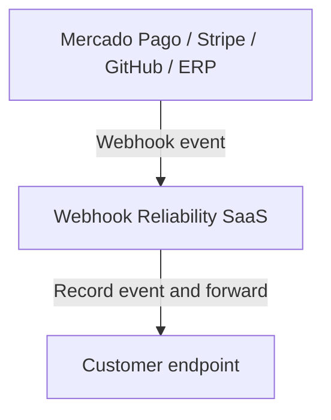

# Kerby API

A REST API built with ASP.NET Core and .NET 10 for managing clients and registering webhook endpoints. The application uses Minimal APIs, organizes operations into modules, and separates endpoints, use cases, and domain models.

## Product vision

Kerby's goal is to act as a reliability layer between webhook producers—such as Mercado Pago, Stripe, GitHub, or an ERP—and the customer system that needs to receive their events. Instead of sending events directly to each customer's system, a producer would send them to Kerby, which would record the event and forward it to the configured customer endpoint.



With this intermediary in place, the service is intended to provide visibility into whether deliveries succeeded and, when a delivery fails, support retrying it. These capabilities describe the product vision; they are not implemented in the current codebase.

> The implemented scope covers client registration and management, as well as webhook endpoint configuration. Receiving and forwarding webhook events are not yet implemented.

## Technologies and dependencies

- .NET 10 / ASP.NET Core
- Entity Framework Core 10.0.10 with the InMemory provider
- FluentValidation 12.1.1
- Microsoft.AspNetCore.OpenApi 10.0.10 and Microsoft.OpenApi 2.11.0
- Scalar.AspNetCore 2.16.11

## Run locally

The .NET 10 SDK is required. From the repository root, run:

```bash
dotnet run --project src/kerby.api/kerby.api.csproj --launch-profile http
```

The `http` profile configures the application to use `http://localhost:8081` and the `Development` environment.

In the development environment, the interactive API reference is available at:

- Scalar: <http://localhost:8081/api-reference>
- OpenAPI document: <http://localhost:8081/openapi/v1.json>

## Endpoints

### Clients

| Method | Route | Description | Main responses |
|---|---|---|---|
| `POST` | `/api/clients/` | Creates a client. | `201 Created` |
| `GET` | `/api/clients/{id}` | Retrieves a client by ID. | `200 OK`, `404 Not Found` |
| `PUT` | `/api/clients/{id}` | Updates a client's details. | `200 OK` |
| `DELETE` | `/api/clients/{id}` | Deletes a client. | `200 OK` |

The client creation and update request body contains the fields `firstName`, `lastName`, `email`, and `phoneNumber`. Example:

```json
{
  "firstName": "Ana",
  "lastName": "Silva",
  "email": "ana@example.com",
  "phoneNumber": "+5511999999999"
}
```

To retrieve, update, or delete a client, replace `{id}` with the UUID returned when the client was created.

### Webhooks

| Method | Route | Description | Main responses |
|---|---|---|---|
| `POST` | `/api/webhooks/` | Registers a webhook endpoint for a client. | `201 Created` |

The request body contains the client ID, a name, a provider, and the destination URL:

```json
{
  "clientId": "00000000-0000-0000-0000-000000000000",
  "name": "Orders",
  "provider": "example",
  "destinationUrl": "https://example.com/webhooks/orders"
}
```

The response includes the endpoint ID, a public token, and a public URL in the `/in/{token}` format. Currently, this URL is informational: no `/in/{token}` inbound route has been implemented.

## Code organization

The API project is located in `src/kerby.api/` and follows a modular organization:

- `Modules/Client/`: client domain and features (`AddClient`, `GetClient`, `UpdateClient`, and `DeleteClient`).
- `Modules/Webhook/`: webhook endpoint domain and features; currently includes `AddEndpoint`.
- `Abstractions/`: contracts, including the `IContext` data access abstraction.
- `Infrastructure/Data/`: Entity Framework Core context implementation.
- `Exceptions/`: global exception handling.
- `Program.cs`: dependency registration, application configuration, and module mapping.

Each feature keeps its endpoints, use cases, and, where applicable, validators in its own folder.

## Persistence and current limitations

The application configures Entity Framework Core with the InMemory provider and a database named `kerbydb`. Data is held only in memory and is not retained when the application restarts. The project does not define a relational database or connection string.

Although FluentValidation is included and a validator exists for the client domain, the feature validators are empty, and no integration was found that executes them automatically.
